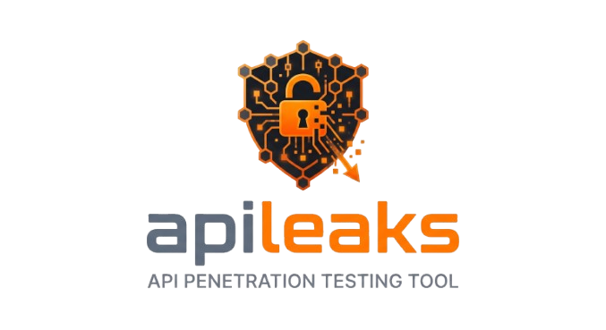

# APILeak v1.0.0

<div align="center">
  
</div>

## APILeak v1.0.0 — Enterprise API Security Testing Tool

**Enterprise-grade API security testing tool with full OWASP API Security Top 10 2023 coverage, JWT attack suite, cloud gateway auditing, and an MCP server that lets AI agents run scans via natural language.**

[](https://opensource.org/licenses/MIT)
[](https://www.python.org/downloads/)
[](https://moisestapia.github.io/apileaks/mcp-server/)
[](https://owasp.org/API-Security/)
[](https://moisestapia.github.io/apileaks/)
[](https://github.com/MoisesTapia/apileaks/releases/latest)

---

## 📖 Documentation

**Full docs site:** **[https://moisestapia.github.io/apileaks/](https://moisestapia.github.io/apileaks/)**

| Guide | Description |
|-------|-------------|
| [MCP Server Guide](https://moisestapia.github.io/apileaks/mcp-server/) | Connect Claude / Kiro and run scans via AI |
| [Docker Deployment](https://moisestapia.github.io/apileaks/mcp-docker/) | Docker & docker-compose for the MCP server |
| [AI Providers](https://moisestapia.github.io/apileaks/mcp-ai-providers/) | Anthropic, OpenAI, Bedrock configuration |
| [MCP Tools Reference](https://moisestapia.github.io/apileaks/mcp-tools-reference/) | JSON Schema for every MCP tool |
| [OWASP Modules Guide](https://moisestapia.github.io/apileaks/owasp-modules-guide/) | All 12 OWASP testing modules |
| [JWT Attack Testing](https://moisestapia.github.io/apileaks/jwt-attacks/) | 8-attack JWT test suite |
| [MCP Security](https://moisestapia.github.io/apileaks/mcp_server_security/) | OWASP MCP Top 10 controls |

---

## 🚀 Quick Start

```bash
# Install
pip install 'apileaks[mcp,ai]'

# Or from source
git clone https://github.com/MoisesTapia/apileaks.git
cd apileaks
pip install -e '.[mcp,ai]'

# Run a scan
apileaks scan --target https://api.example.com

# See all commands
apileaks --help
```

---

## 🤖 MCP Server — AI Agent Integration

APILeak v1.0.0 exposes every scan capability as an MCP tool. Connect Claude Desktop, Kiro, or any MCP-compatible AI agent and run full API security tests via natural language.

### Connect Claude Desktop (stdio — 1 config line)

Edit `~/Library/Application Support/Claude/claude_desktop_config.json` (macOS) or
`%APPDATA%\Claude\claude_desktop_config.json` (Windows):

```json
{
  "mcpServers": {
    "apileaks": {
      "command": "apileaks",
      "args": ["mcp-server", "--transport", "stdio"]
    }
  }
}
```

Restart Claude. The `apileaks` toolset appears automatically.

### Connect Kiro

In `.kiro/settings/mcp.json`:

```json
{
  "mcpServers": {
    "apileaks": {
      "command": "apileaks",
      "args": ["mcp-server", "--transport", "stdio"]
    }
  }
}
```

### HTTP server (persistent, multi-client)

```bash
export APILEAKS_MCP_AUTH_TOKEN=$(python -c "import secrets; print(secrets.token_urlsafe(32))")
apileaks mcp-server --transport http --port 8080
```

### Docker Compose

```bash
echo "APILEAKS_MCP_AUTH_TOKEN=change-me" > .env
docker compose --profile mcp up -d
# Server available at http://localhost:8080/sse
```

### What the AI agent can do

Once connected, you can ask your AI agent:

> *"Run a full OWASP scan against https://staging.api.com using Bearer token eyJ..."*
> *"Test the /users/{id} endpoint for BOLA. Check IDs 1 through 100."*
> *"Audit the JWT implementation. Here's a sample token: eyJhbGci..."*

The AI invokes the appropriate tools (`apileak.scan`, `apileak.owasp.bola_testing`, `apileak.jwt.attack_test`, etc.) and returns structured findings.

**Security**: Destructive tools require a `ConfirmationToken` — the AI cannot execute them without explicit human confirmation. Every invocation is logged to an append-only audit trail (OWASP MCP08).

---

## 📋 Command Overview

```
apileaks --help
```

| Command | Description |
|---------|-------------|
| `apileaks scan` | Orchestrated scan — discovery + all (or selected) OWASP modules |
| `apileaks owasp <module>` | Run a single OWASP module in isolation |
| `apileaks dir` | Directory/endpoint fuzzing with triage |
| `apileaks par` | Hidden parameter discovery |
| `apileaks brute` | Brute-force exposed API spec files |
| `apileaks jwt <subcommand>` | JWT attack & utility toolkit (13 subcommands) |
| `apileaks cloud-audit` | Cloud API gateway security audit (AWS / GCP / Azure) |
| `apileaks mcp-server` | Start the MCP server (stdio or HTTP/SSE) |
| `apileaks mcp-audit` | Audit a third-party MCP server for security issues |
| `apileaks replay <report>` | Re-issue requests from a prior scan report |
| `apileaks wordlist` | Manage Assetnote wordlists |

---

## ✨ Features

### OWASP API Security Top 10 (2023) — 12 modules

| Module | CLI key | OWASP Category |
|--------|---------|----------------|
| BOLA / IDOR | `bola` | API1:2023 |
| Broken Authentication | `auth` | API2:2023 |
| Mass Assignment | `property` | API3:2023 |
| Resource Consumption | `resource` | API4:2023 |
| BFLA | `function` | API5:2023 |
| Business Flows | `business` | API6:2023 |
| SSRF | `ssrf` | API7:2023 |
| Security Misconfiguration | `security` | API8:2023 |
| Inventory Management | `inventory` | API9:2023 |
| Unsafe Consumption | `unsafe` | API10:2023 |
| HTTP Parameter Pollution | `parameter_pollution` | *(beyond Top 10)* |
| OpenAPI Contract Audit | `spec_driven_testing` | *(beyond Top 10)* |

### JWT Attack Suite (8 attacks)

```bash
apileaks jwt attack-test --target https://api.example.com/protected --token eyJ...
```

- None algorithm bypass
- Weak secret brute-force (HS256/384/512)
- RS256 → HS256 algorithm confusion
- JWK header injection
- `kid` SQL injection / path traversal
- Expired token replay
- `sub` claim manipulation

### AI-Assisted Features (optional — `apileaks[ai]`)

```bash
# LLM finding triage and prioritisation
apileaks scan --target URL --ai-triage

# Semantic deduplication of overlapping module findings
apileaks scan --target URL --ai-dedup

# Both
apileaks scan --target URL --ai-triage --ai-dedup
```

Supports **Anthropic** (Claude), **OpenAI** (GPT), and **Amazon Bedrock**.
Set the provider in `config/apileaks.yaml` + the corresponding API key env var.
Graceful degradation: if the provider is unavailable, the scan completes without the AI section.

### Cloud API Gateway Audit

```bash
# AWS API Gateway
apileaks cloud-audit --provider aws \
  --target https://api-id.execute-api.us-east-1.amazonaws.com

# Google Cloud API Gateway
apileaks cloud-audit --provider gcp --target https://gateway.example.com

# Azure API Management
apileaks cloud-audit --provider azure \
  --target https://apim-name.azure-api.net
```

### MCP Security Self-Audit

```bash
# Audit any MCP server (including yourself)
apileaks mcp-audit --target "apileaks mcp-server --transport stdio"
apileaks mcp-audit --target http://mcp.example.com --fail-on-findings
```

Checks: tool poisoning, SSRF via URL params, missing confirmation gates, credential leaks in responses.

---

## 🛠️ Usage Examples

### Full scan with CI gate

```bash
apileaks scan \
  --target https://api.example.com \
  --modules bola,auth,ssrf,property \
  --openapi https://api.example.com/openapi.json \
  --ci-mode \
  --fail-on high \
  --sarif \
  --output-file report.sarif
```

### OWASP modules individually

```bash
# List all modules with descriptions
apileaks owasp

# BOLA — test horizontal privilege escalation
apileaks owasp bola --target https://api.example.com --auth-token "Bearer eyJ..."

# SSRF — probe URL-accepting parameters
apileaks owasp ssrf --target https://api.example.com

# Spec contract audit (OpenAPI)
apileaks owasp spec_driven_testing \
  --target https://api.example.com \
  --openapi https://api.example.com/openapi.json
```

### Discovery

```bash
# Directory fuzzing
apileaks dir --target https://api.example.com --wordlist wordlists/endpoints.txt

# With Assetnote wordlists
apileaks wordlist fetch apiroutes-210328
apileaks dir --target https://api.example.com --wordlist assetnote:apiroutes-210328:20000

# Parameter fuzzing
apileaks par --target https://api.example.com/search

# API spec brute-force
apileaks brute --target https://api.example.com
```

### Advanced scan options

```bash
# Framework detection + version fuzzing
apileaks scan --target URL --detect-framework --fuzz-versions

# WAF evasion
apileaks scan --target URL --user-agent-random --enable-waf-evasion

# Multi-target from file
apileaks scan --target-file hosts.txt --max-hosts 50

# Replay requests from a previous scan
apileaks replay reports/scan_2026-11-03.json
```

---

## 🐳 Docker

```bash
# Base image (scanner only)
docker build -t apileak:latest .
docker run --rm apileak:latest scan --target https://api.example.com

# MCP server image
docker build -f Dockerfile.mcp -t apileak-mcp:latest .

# docker-compose — full MCP stack
APILEAKS_MCP_AUTH_TOKEN=secret docker compose --profile mcp up -d

# Run the security self-audit
docker compose --profile mcp-audit up --abort-on-container-exit
```

See [Docker Deployment Guide](https://moisestapia.github.io/apileaks/mcp-docker/) for TLS, reverse proxy, and CI/CD details.

---

## 📦 Installation

### Requirements

- Python 3.11+
- pip / uv / pipx

### Extras

| Extra | Installs | Use for |
|-------|----------|---------|
| `apileaks[mcp]` | MCP SDK, jsonschema, starlette, uvicorn | `mcp-server`, `mcp-audit` |
| `apileaks[ai]` | anthropic, openai | `--ai-triage`, `--ai-dedup` |
| `apileaks[ai,aws]` | + boto3 | Amazon Bedrock provider |
| `apileaks[gcp]` | google-cloud-api-gateway | GCP cloud audit |
| `apileaks[azure]` | azure-identity, azure-mgmt | Azure cloud audit |
| `apileaks[dev]` | pytest, hypothesis, ruff, mypy | Development |

```bash
# Minimal (scanner only)
pip install apileaks

# MCP + AI
pip install 'apileaks[mcp,ai]'

# Everything
pip install 'apileaks[mcp,ai,aws,gcp,azure]'
```

---

## 🔒 Security

- All 10 OWASP MCP Top 10 controls implemented in the MCP server
- Append-only audit log for every tool invocation
- Destructive tools require explicit human `ConfirmationToken`
- Hash-verified MCP SDK supply chain (`requirements-mcp.txt`)
- CI self-audit: the MCP server audits itself before every release

See [MCP Security Documentation](https://moisestapia.github.io/apileaks/mcp_server_security/) and [SECURITY.md](SECURITY.md).

---

## 🤝 Contributing

See [CONTRIBUTING.md](CONTRIBUTING.md) for development setup, coding standards (ruff, mypy, pytest), MCP SDK version bump policy, and PR workflow.

## 📄 License

[MIT License](LICENSE) — free to use, modify, and distribute.

---

<div align="center">

**[Docs](https://moisestapia.github.io/apileaks/)** · **[Releases](https://github.com/MoisesTapia/apileaks/releases)** · **[Issues](https://github.com/MoisesTapia/apileaks/issues)**

Built for API security professionals.

</div>
