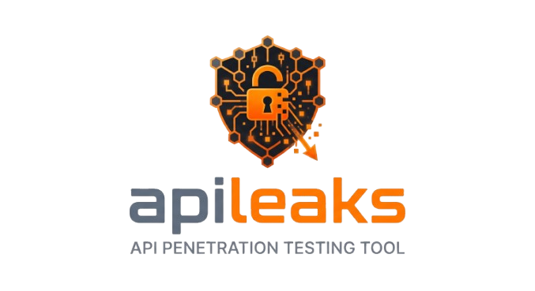

# APILeak v0.3.0

<div align="center">
  
</div>

**Enterprise-grade API security testing tool with full OWASP API Security Top 10 2023 coverage, JWT attack testing, and a built-in MCP server that lets AI agents like Claude or Kiro run security scans via natural language.**

[](https://opensource.org/licenses/MIT)
[](https://www.python.org/downloads/)
[](https://owasp.org/API-Security/)
[](docs/mcp-server.md)

---

## What is APILeak?

APILeak is a CLI and MCP-based tool for automated penetration testing of REST APIs. It combines:

- **12 OWASP testing modules** covering the full API Security Top 10 2023 + HPP + spec-driven testing
- **JWT attack suite** — 8 attack types including none algorithm, weak secret brute-force, algorithm confusion, and key injection
- **Endpoint and parameter discovery** — directory fuzzing, parameter fuzzing, OpenAPI-aware scanning
- **Cloud gateway audits** — AWS API Gateway, Google Cloud API Gateway, Azure APIM
- **MCP server** — exposes all of the above as tools for AI agents (Claude Desktop, Kiro, custom agents)
- **AI triage and deduplication** — optional LLM-assisted finding prioritisation (Anthropic, OpenAI, Bedrock)

---

## 5-Minute Quick Start

=== "pip"

    ```bash
    pip install 'apileaks[mcp]'
    apileaks scan --target https://api.example.com
    ```

=== "Docker"

    ```bash
    # Pull or build
    docker build -f Dockerfile.mcp -t apileak-mcp:latest .

    # Run a scan
    docker run --rm apileak-mcp:latest \
      python apileaks.py scan --target https://api.example.com
    ```

=== "From source"

    ```bash
    git clone https://github.com/MoisesTapia/apileaks.git
    cd apileaks
    pip install -e '.[mcp,ai]'
    apileaks scan --target https://api.example.com
    ```

---

## Start the MCP Server

Give your AI agent full access to APILeak:

=== "stdio (Claude Desktop / Kiro)"

    Add to your Claude Desktop config (`claude_desktop_config.json`):
    ```json
    {
      "mcpServers": {
        "apileaks": {
          "command": "apileaks",
          "args": ["mcp-server", "--transport", "stdio"]
        }
      }
    }
    ```
    Restart Claude Desktop. APILeak tools appear in the tools panel.

=== "HTTP (persistent server)"

    ```bash
    export APILEAKS_MCP_AUTH_TOKEN=$(python -c "import secrets; print(secrets.token_urlsafe(32))")
    apileaks mcp-server --transport http --port 8080
    ```

=== "Docker Compose"

    ```bash
    echo "APILEAKS_MCP_AUTH_TOKEN=changeme" > .env
    docker compose --profile mcp up -d
    # Server available at http://localhost:8080/sse
    ```

Once connected, you can ask Claude:

> *"Run a full OWASP scan against https://staging.mycompany.com/api using Bearer token eyJ..."*

And Claude will invoke `apileak.scan` with the appropriate parameters, stream progress, and return a structured finding report.

---

## What Can the AI Agent Do?

| Capability | Tool | Notes |
|------------|------|-------|
| Full OWASP scan | `apileak.scan` | All 12 modules + discovery |
| BOLA / IDOR testing | `apileak.owasp.bola_testing` | API1:2023 |
| JWT attacks | `apileak.jwt.attack_test` | 8 attack types |
| SSRF testing | `apileak.owasp.ssrf_testing` | Cloud metadata, blind SSRF |
| Auth testing | `apileak.owasp.auth_testing` | API2:2023 |
| Mass assignment | `apileak.owasp.property_level_auth` | API3:2023 |
| Endpoint discovery | `apileak.discovery.dir` | Wordlist fuzzing |
| Parameter discovery | `apileak.discovery.par` | Hidden parameters |
| Cloud audit | `apileak.cloud_audit` | AWS, GCP, Azure ⚠️ Destructive |
| + 6 more OWASP modules | … | API4–API10 + HPP + Spec |

Destructive tools (those that modify state) require a `ConfirmationToken` — the AI cannot execute them without explicit human confirmation.

---

## Documentation Map

<div class="grid cards" markdown>

-   :material-rocket-launch: **[Getting Started](installation.md)**

    ---
    Install APILeak, set up your environment, run your first scan.

-   :material-robot: **[MCP Server Guide](mcp-server.md)**

    ---
    Connect Claude Desktop, Kiro, or any MCP client to APILeak in minutes.

-   :material-docker: **[Docker Deployment](mcp-docker.md)**

    ---
    Run the MCP server in containers with docker compose.

-   :material-shield-check: **[OWASP Modules](owasp-modules-guide.md)**

    ---
    Deep dives into each of the 12 OWASP testing modules.

-   :material-key: **[JWT Attack Testing](jwt-attacks.md)**

    ---
    Comprehensive JWT attack suite — 8 attack types explained.

-   :material-brain: **[AI Providers](mcp-ai-providers.md)**

    ---
    Configure Anthropic, OpenAI, or Amazon Bedrock for AI triage.

-   :material-tools: **[MCP Tools Reference](mcp-tools-reference.md)**

    ---
    Complete JSON Schema and examples for every MCP tool.

-   :material-lock: **[MCP Security](mcp_server_security.md)**

    ---
    OWASP MCP Top 10 controls, self-audit results, security policies.

</div>

---

## Command Overview

| Command | Purpose |
|---------|---------|
| `apileaks scan` | Orchestrated scan — discovery + all (or selected) OWASP modules |
| `apileaks owasp <module>` | Run a single OWASP module in isolation |
| `apileaks dir` | Directory/endpoint fuzzing |
| `apileaks par` | Hidden parameter discovery |
| `apileaks jwt <subcommand>` | JWT attack and utility toolkit |
| `apileaks mcp-server` | Start the MCP server (stdio or HTTP) |
| `apileaks mcp-audit` | Audit a third-party MCP server for security issues |
| `apileaks cloud-audit` | Cloud API gateway security audit |
| `apileaks replay <report>` | Re-issue requests from a prior scan report |

---

## Security Philosophy

APILeak is built with the same security controls it tests for in others:

- **No AI-initiated destructive actions** — AI agents must receive a human confirmation token for any destructive scan
- **Append-only audit log** — every tool invocation is recorded; no handler can erase it
- **Hash-verified supply chain** — MCP SDK pinned with `==`; `requirements-mcp.txt` generated with `pip-compile --generate-hashes`
- **Self-audit (dogfooding)** — `apileaks mcp-audit` runs against the MCP server itself in CI before every release
- **OWASP MCP Top 10** — all 10 controls implemented; see [MCP Security docs](mcp_server_security.md)

---

## Contributing

See [CONTRIBUTING.md](https://github.com/MoisesTapia/apileaks/blob/main/CONTRIBUTING.md) for:
- Development setup
- Coding standards (ruff, mypy, pytest)
- MCP SDK version bump policy
- Pull request workflow

---

## License

[MIT License](https://github.com/MoisesTapia/apileaks/blob/main/LICENSE) — free to use, modify, and distribute.
